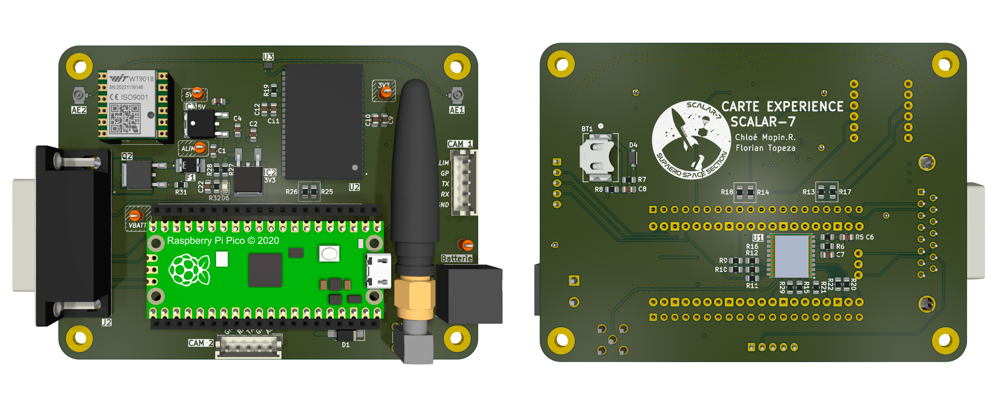
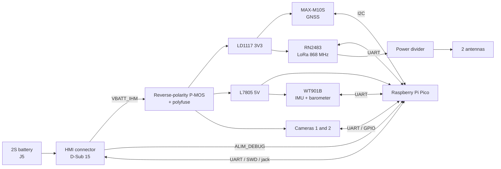

<p align="center">
  
</p>

# SCALAR-7 : Carte Experience Bas

<p align="center">
  
  
  
  
</p>

Experiment board of the **lower stage** of **SCALAR-7**, a two-stage rocket launched at **C'Space 2026**.
It measures the stage's flight parameters (accelerations, angular rates, attitude, pressure, altitude, temperature), tracks its position with GNSS, controls two onboard cameras and downlinks its data to the ground over LoRa.

---
## Table of contents

- [Board features](#board-features)
- [Architecture](#architecture)
  - [Power supply](#power-supply)
  - [Microcontroller](#microcontroller)
  - [Telemetry](#telemetry)
  - [Experiments](#experiments)
  - [HMI connection](#hmi-connection)
- [Main components](#main-components)
- [Repository structure](#repository-structure)

---

## Board features

| Function | Implementation |
|---|---|
| Processing / logging | Raspberry Pi **Pico** (RP2040) |
| Flight measurements | **WitMotion WT901B** inertial measurement unit: accelerometer, gyroscope, magnetometer, barometer, temperature (UART, I²C optional) |
| Positioning | **u-blox MAX-M10S** GNSS module (I²C, UART optional) |
| Ground link | **Microchip RN2483** LoRa 868 MHz module (UART), RF output split across two antennas |
| Video | Two JST connectors for the cameras (power, UART, control GPIOs) |
| Power supply | 2S battery, protected input (reverse polarity, overcurrent), 3.3 V and 5 V regulators |
| HMI interface | D-Sub 15 connector: power, jack, status LED, debug UART and SWD, camera control |
| Indicators | Power LED, GNSS PPS LED |

---

## Architecture



### Power supply

The board is powered by a **2S** battery. The supply goes through the HMI before coming back to the board, so the board can be switched on from the outside. The input is protected against reverse polarity (P-MOSFET) and overcurrent (polyfuse), then two linear regulators generate the **3V3** rail (GNSS, LoRa) and the **5V** rail (Pico, IMU). The cameras are powered directly from the protected battery line.

### Microcontroller

A **Raspberry Pi Pico** handles IMU and GNSS acquisition, camera control and LoRa frame transmission. It is mounted on two pin headers that also serve as test points. Its VSYS input is supplied either by the board's 5V rail or by the HMI debug supply through two diodes, so it can be programmed without the battery.

### Telemetry

- **GNSS**: a **u-blox MAX-M10S** module provides the position and a PPS signal. It connects to an external antenna and keeps its data in memory thanks to a backup battery.
- **LoRa**: an **RN2483** module (868 MHz, UART) sends the data to the ground. Its RF output is split across two antennas by a power divider.

### Experiments

- **Flight measurements**: **WT901B** inertial measurement unit, connected over UART. It provides accelerations, angular rates, attitude, pressure, altitude and temperature.
- **Video**: two cameras, powered by the board and controlled over UART and GPIO.

### HMI connection

The **D-Sub 15** connector links the board to the HMI. It carries the battery supply (out and back, for switching the board on), the jack, the status LED, the Pico's debug UART and SWD, and the camera control GPIOs.

---

## Main components

| Ref. | Component | Function |
|---|---|---|
| — | Raspberry Pi Pico | Microcontroller |
| U1 | u-blox MAX-M10S | GNSS receiver |
| U2 | Microchip RN2483 | LoRa 868 MHz module |
| U3 | PD0810J5050S2HF | RF power divider |
| W1 | WitMotion WT901B | IMU with barometer |
| IC2 | ST LD1117DT33TR | 3.3 V regulator |
| IC3 | ST L7805CDT-TR | 5 V regulator |
| Q2 | Vishay SQD50P04-13L | Reverse-polarity protection |
| F1 | Littelfuse 1812L260/16MR | Polyfuse |
| J2 | D-Sub 15 | HMI connection |
| J8, J9 | 5-pin connectors | Cameras |

---

## Repository structure

```
SCALAR-7_Carte_Experience_Bas/
├── hardware/          # KiCad project
├── images/
├── schematic.pdf
└── README.md
```

---